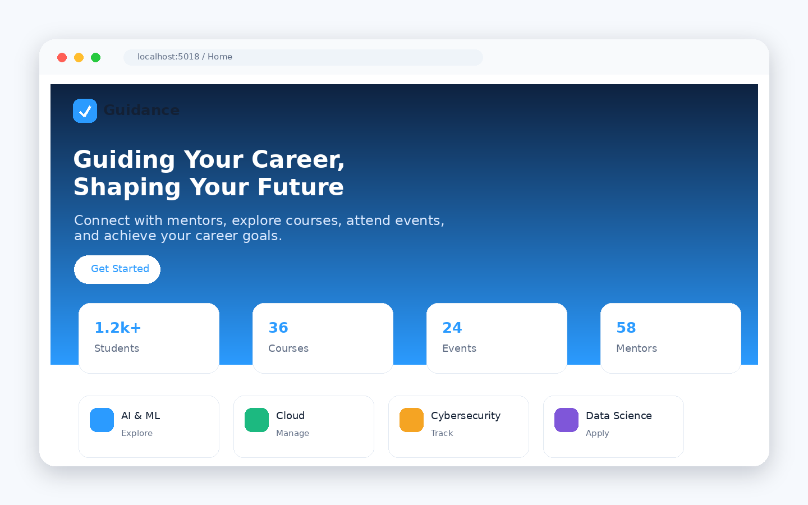
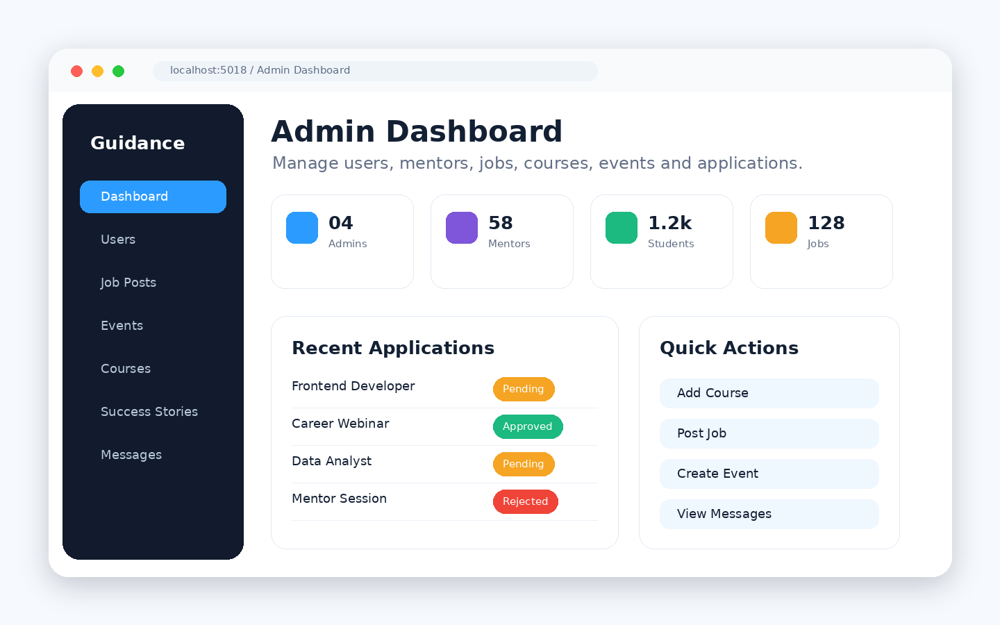
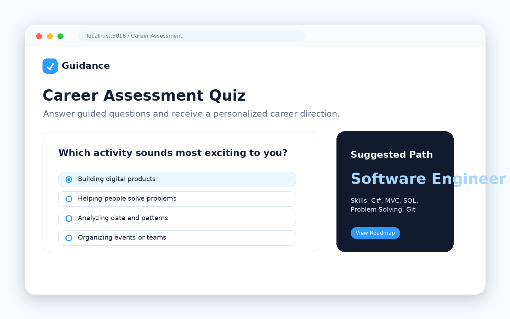
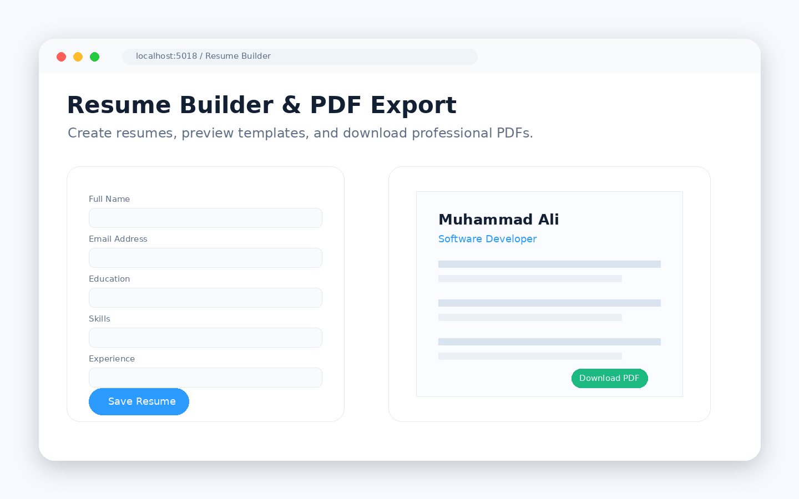
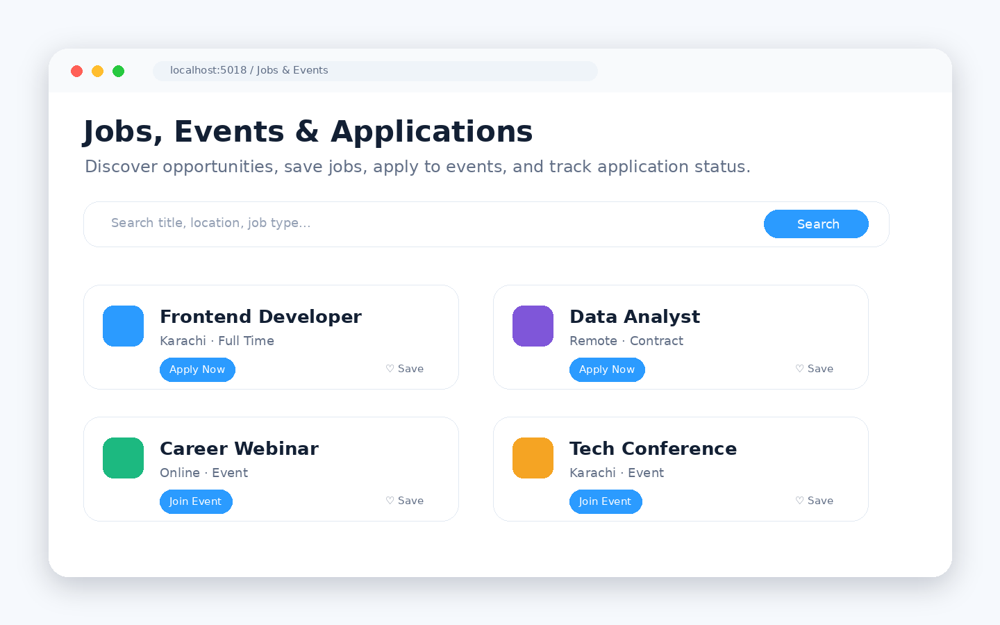
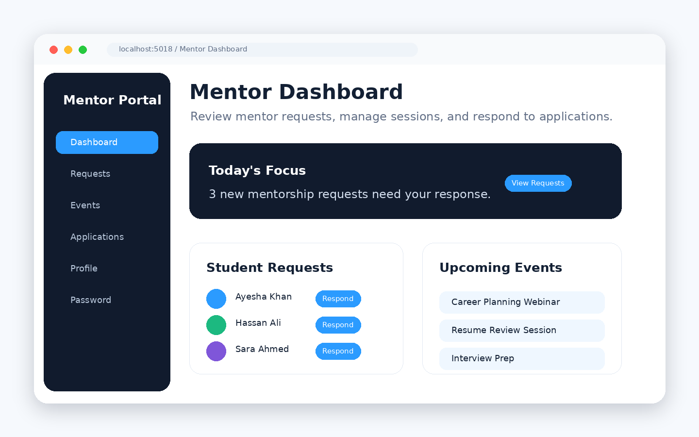

# CareerGuidance — ASP.NET Core Career Development Platform

<p align="center">
  
</p>

<p align="center">
  <b>A complete career guidance web platform for students, mentors, and administrators.</b><br />
  Explore courses, jobs, events, mentors, career assessments, goals, resumes, quizzes, and application workflows from one MVC application.
</p>

<p align="center">
  
  
  
  
</p>

---

## Preview

| Home Page | Admin Dashboard |
|---|---|
|  |  |

| Career Assessment | Resume Builder |
|---|---|
|  |  |

| Jobs & Events | Mentor Dashboard |
|---|---|
|  |  |

> The screenshot files are included in `docs/screenshots/` so the README renders correctly on GitHub. Replace them with live browser screenshots after deployment if you want production-accurate captures.

---

## Table of Contents

- [About the Project](#about-the-project)
- [Core Features](#core-features)
- [Tech Stack](#tech-stack)
- [Project Structure](#project-structure)
- [Getting Started](#getting-started)
- [Database Setup](#database-setup)
- [Run the Application](#run-the-application)
- [Roles](#roles)
- [Useful Routes](#useful-routes)
- [GitHub Setup](#github-setup)
- [License](#license)
- [Author](#author)

---

## About the Project

**CareerGuidance** is a full-stack ASP.NET Core MVC application built to help students plan, learn, apply, and grow in their career journey. It includes a public website, authentication, role-based portals, career discovery, mentor workflows, course management, job applications, event registrations, resume generation, quizzes, achievements, and admin controls.

This repository is prepared for GitHub with a clean `.gitignore`, MIT license, and a polished README with screenshot-ready documentation.

---

## Core Features

### Public Website

- Modern landing page with hero section, course highlights, jobs, mentors, events, and success stories
- Public browsing for courses, jobs, mentors, events, achievements, and pricing pages
- Contact/message workflow for user support

### Authentication & Roles

- Signup and login system
- Cookie authentication and session handling
- Role-based redirects for Admin, Mentor, and User accounts
- Password hashing using ASP.NET Core Identity `PasswordHasher`

### Student/User Portal

- User dashboard and profile management
- Career assessment quiz with suggested career result
- Career roadmap and job role exploration
- Goal creation, goal steps, progress tracking, and recycle bin restore/delete actions
- Resume builder with preview and PDF download
- Saved jobs and job applications
- Event applications and mentor request tracking

### Mentor Portal

- Mentor dashboard
- Mentor personal profile management
- Mentor request review and response workflow
- Mentor event management
- Event application response with optional meeting links

### Admin Portal

- Admin dashboard with user, mentor, course, job, event, achievement, and application controls
- User and mentor management
- Job posting CRUD and closed-job cleanup
- Course CRUD with images, trainer info, video, references, comments, and quizzes
- Admin event CRUD for conferences and webinars
- Job/event application review with approve/reject status updates
- Success story/achievement management
- Contact message replies

### Career & Learning Tools

- Career assessment module
- Coding quiz module with category-based questions
- Career roadmap service using JSON data
- Course comments and threaded replies
- Resume PDF generation with Rotativa/wkhtmltopdf

---

## Tech Stack

| Layer | Technology |
|---|---|
| Framework | ASP.NET Core MVC |
| Runtime | .NET 8 |
| Database | SQL Server |
| ORM | Entity Framework Core |
| Authentication | Cookie Authentication + Sessions |
| PDF Export | Rotativa.AspNetCore / wkhtmltopdf |
| Frontend | Razor Views, Bootstrap, Bootstrap Icons, custom CSS |
| Language | C# |
| IDE | Visual Studio / VS Code |

---

## Project Structure

```text
CareerGuidance/
├── CareerGuidance.sln
├── .gitignore
├── LICENSE
├── README.md
├── docs/
│   └── screenshots/
└── CareerGuidance/
    ├── Controllers/
    ├── Migrations/
    ├── Models/
    ├── Services/
    ├── Views/
    ├── wwwroot/
    │   ├── css/
    │   ├── data/
    │   ├── images/
    │   ├── js/
    │   ├── vendor/
    │   └── Rotativa/
    ├── Program.cs
    ├── appsettings.json
    └── CareerGuidance.csproj
```

---

## Getting Started

### Prerequisites

Install the following before running the project:

- [.NET 8 SDK](https://dotnet.microsoft.com/download/dotnet/8.0)
- SQL Server or SQL Server Express
- Visual Studio 2022, Visual Studio Code, or JetBrains Rider
- Entity Framework Core CLI tools

Install EF Core tools if you do not already have them:

```bash
dotnet tool install --global dotnet-ef
```

---

## Database Setup

1. Open `CareerGuidance/appsettings.json`.
2. Update the connection string for your SQL Server instance:

```json
"ConnectionStrings": {
  "DefaultConnection": "Server=YOUR_SERVER_NAME;Database=CareerGuidanceDb;Trusted_Connection=True;MultipleActiveResultSets=true;TrustServerCertificate=True"
}
```

3. From the repository root, apply migrations:

```bash
dotnet ef database update --project CareerGuidance/CareerGuidance.csproj
```

This creates the `CareerGuidanceDb` database schema using the included Entity Framework migrations.

---

## Run the Application

From the repository root:

```bash
dotnet restore
dotnet build
dotnet run --project CareerGuidance/CareerGuidance.csproj
```

Default launch URLs from `launchSettings.json`:

```text
https://localhost:7221
http://localhost:5018
```

---

## Roles

The application uses numeric role IDs:

| Role ID | Role | Main Area |
|---:|---|---|
| 1 | Admin | `/Admin` |
| 2 | Mentor | `/Mentor` |
| 3 | User/Student | `/User` and public site |

> No public seed credentials are documented in this repository. Create accounts through signup or seed users directly in the database according to your local setup.

---

## Useful Routes

| Module | Route |
|---|---|
| Home | `/Home/Index` |
| Login | `/Auth/Login` |
| Signup | `/Auth/Signup` |
| Admin Dashboard | `/Admin/Index` |
| Mentor Dashboard | `/Mentor/Index` |
| User Dashboard | `/User/Index` |
| Courses | `/Home/Courses` |
| Jobs | `/Home/JobList` |
| Events | `/Home/Events` |
| Mentors | `/Home/Mentors` |
| Career Assessment | `/CareerAssessment/TakeQuiz` |
| Resume Builder | `/Resume/Index` |
| Saved Jobs | `/SavedJobs/SavedJobs` |
| Goals | `/Goal/Index` |

---

## GitHub Setup

Initialize Git and push the project:

```bash
git init
git add .
git commit -m "Initial commit: CareerGuidance ASP.NET Core MVC project"
git branch -M main
git remote add origin https://github.com/CodeByMan/career-guidance-aspnet-core.git
git push -u origin main
```

If your repository has a different name, replace the remote URL before pushing.

---

## Recommended Improvements

- Move production secrets out of `appsettings.json` and into environment variables or user secrets
- Add seed data for demo admin, mentor, and student accounts
- Add unit/integration tests for controllers and services
- Add deployment instructions for IIS, Azure App Service, or Docker
- Capture live screenshots from the running application and replace the preview images in `docs/screenshots/`

---

## License

This project is licensed under the **MIT License**. See the [LICENSE](LICENSE) file for details.

---

## Author

**Muhammad Ali Nawaz**

- GitHub: [CodeByMan](https://github.com/CodeByMan)
- Project: CareerGuidance ASP.NET Core MVC Platform

---

<p align="center">
  Made with ASP.NET Core MVC, SQL Server, Bootstrap, and a focus on career growth.
</p>
