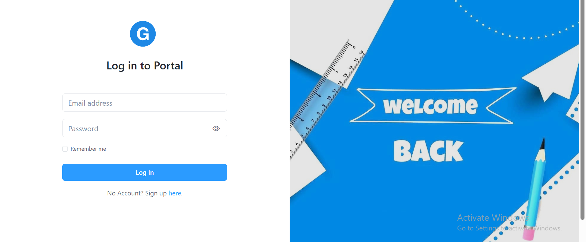
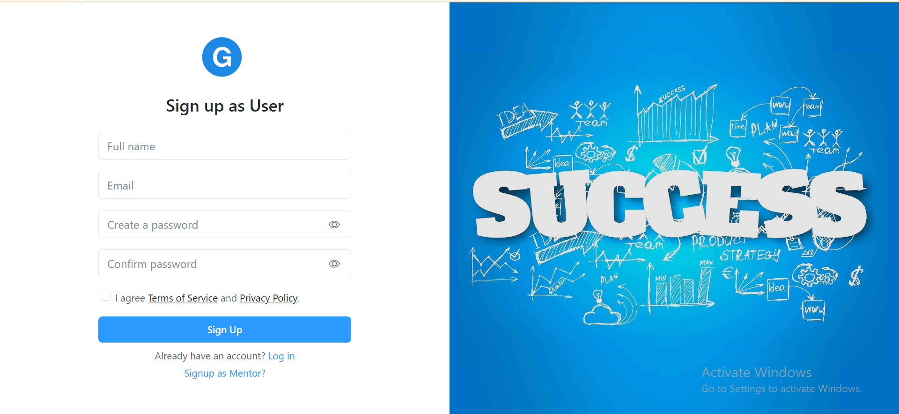

<h1 align="center">🎯 CareerGuidance</h1>

<p align="center">
  <b>An ASP.NET Core MVC career development platform with courses, jobs, mentors, career assessments, goals, resume builder, event applications, role-based dashboards, and admin management.</b>
</p>

<p align="center">
  
  
  
  
  
  
  
  
</p>

<p align="center">
  <b>Career Courses</b> •
  <b>Job Portal</b> •
  <b>Mentorship</b> •
  <b>Resume Builder</b> •
  <b>Career Assessment</b> •
  <b>Admin Dashboard</b>
</p>

---

## 📸 Project Screenshots

Homepage


| Login | Register |
|---|---|
|  |  |

---

## 🚀 Project Overview

**CareerGuidance** is a full-stack ASP.NET Core MVC web application designed to help students and job seekers plan their career journey from learning to employment.

The platform includes a public career website, user dashboard, mentor dashboard, and admin dashboard. Visitors can explore courses, jobs, mentors, events, achievements, and career resources. Registered users can create goals, generate roadmap steps, build resumes, download resumes as PDF, save jobs, apply for jobs and events, request mentors, take career assessments, and track their own applications.

Admins can manage platform content such as users, mentors, jobs, courses, events, achievements, applications, and contact messages. Mentors can maintain their profile, publish webinars, handle mentorship requests, and respond to event applications.

This project demonstrates practical ASP.NET Core MVC development using **.NET 8**, **Razor Views**, **Entity Framework Core**, **SQL Server**, **cookie authentication**, **role-based authorization**, file uploads, PDF generation, and multi-role dashboard workflows.

---

## 🎯 Project Purpose

Career platforms need more than static course and job listings. A practical career guidance system should support learning paths, career roadmaps, mentor interaction, job applications, resume building, assessments, and administrative moderation.

**CareerGuidance** solves this by combining career discovery, learning resources, mentorship, job search, resume generation, and application tracking in one ASP.NET Core MVC platform.

This project is designed as a portfolio-ready .NET web application that demonstrates real-world MVC architecture, SQL Server persistence, authentication, authorization, dashboard development, content management, and user workflows.

---

## 🎯 Key Highlights

- 🎯 Career guidance and student development platform
- 👤 User, mentor, and admin role-based access
- 🔐 Cookie authentication with claims-based roles
- 🧑‍🏫 Mentor listing and mentorship request workflow
- 📚 Course catalog with trainer information and comments
- 🧪 Career assessment and coding quiz modules
- 🧭 Career roadmap data from JSON resources
- ✅ Goal management with auto-suggested roadmap steps
- 💼 Job portal with job details, applications, and saved jobs
- 📄 Resume builder with multiple PDF templates
- 📥 Job and event application tracking
- 🗓️ Admin and mentor event management
- 🏆 Achievement and testimonial management
- 💬 Contact message and admin reply workflow
- 🧑‍💼 Admin dashboard with platform statistics
- 📁 File uploads for users, mentors, courses, jobs, events, achievements, and resumes
- 📊 Dashboard UI assets with Chart.js support
- 🎨 Bootstrap, Razor Views, custom CSS, and static frontend assets

---

## ✨ Features

### 🌐 Public Website Features

| Feature | Description |
|---|---|
| Homepage | Landing page with career guidance messaging, courses, mentors, counters, and testimonials |
| Courses | Browse available skill-development courses |
| Course Details | View course details, trainer profile, course resources, video access, and comments |
| Jobs | Browse job listings with title, location, type, salary, deadline, and company details |
| Job Details | View complete job information and apply when authenticated |
| Mentors | Explore mentor profiles with degree, current post, specialization, and profile image |
| Events | View webinars/conferences and apply to relevant events |
| Achievements | View success stories and career achievement profiles |
| Pricing | Static pricing/information page included in the public website |
| Contact | Send contact messages and review replies when authenticated |

---

### 👤 User Features

| Feature | Description |
|---|---|
| User Registration | Sign up as a student/user through the registration page |
| User Dashboard | Authenticated user area for career actions and personal management |
| Profile Management | Update profile image and personal account information |
| Password Update | Change password securely using ASP.NET password hashing |
| Career Assessment | Take a career assessment quiz and view suggested career results |
| Coding Quiz | Take category-based coding quizzes such as HTML, CSS, and JavaScript |
| Goals | Create career goals with title, type, description, and target date |
| Roadmap Steps | Add manual goal steps or auto-generate roadmap steps from JSON career roadmaps |
| Resume Builder | Create, edit, preview, and manage resumes |
| PDF Resume Export | Download generated resumes as PDF using Rotativa |
| Saved Jobs | Save and remove jobs from the personal saved jobs list |
| Job Applications | Apply for jobs with resume upload, portfolio, and cover letter |
| Event Applications | Apply for career events and track application status |
| Mentor Requests | Send requests to mentors and track accepted, rejected, or scheduled requests |
| Recycle Bin | Restore or permanently delete soft-deleted user items |

---

### 🧑‍🏫 Mentor Features

| Feature | Description |
|---|---|
| Mentor Registration | Sign up as mentor using the registration role toggle |
| Mentor Dashboard | Dedicated mentor portal after login |
| Personal Information | Manage specialization, description, degree, experience, current company, post, and work status |
| Profile Image | Upload mentor profile image |
| Mentor Requests | View user mentorship requests |
| Request Response | Accept, reject, or schedule mentorship requests with meeting links |
| Webinar Management | Create, edit, and manage mentor-hosted webinar events |
| Event Applications | View applicants for mentor events and respond with status/meeting details |
| Password Update | Change mentor account password securely |

---

### 🧑‍💼 Admin Panel Features

| Feature | Description |
|---|---|
| Admin Dashboard | Displays counts for admins, mentors, users, jobs, conferences, webinars, courses, and achievements |
| User Management | View and manage regular platform users |
| Mentor Management | View and manage mentor accounts |
| Job Management | Create, edit, delete, close, and manage job listings |
| Closed Jobs | Review closed/expired job listings and clean up closed job records |
| Course Management | Create, update, view, and delete courses with course media and trainer images |
| Event Management | Create and manage admin-hosted conference events |
| Achievement Management | Manage success stories and achievement/testimonial records |
| Job Applications | Review job applications by job and update application status |
| Event Applications | Review event applications and update event applicant status |
| Contact Messages | View contact messages and send admin replies |
| Admin Profile | Update admin profile image and password |

---

### 📚 Course & Quiz Features

| Feature | Description |
|---|---|
| Course Catalog | Stores title, category, description, fee, trainer name, images, and video path |
| Course Media | Supports course image, trainer image, and course video upload |
| Comments | Users can add, edit, reply to, and delete course comments |
| Nested Replies | Course comments support parent-child replies |
| Quiz Category | Courses can be connected to quiz categories through `QuizCategory` |
| Coding Quiz JSON | Coding questions are loaded from `wwwroot/data/coding_quiz.json` |
| Assessment JSON | Career assessment questions are loaded from `wwwroot/data/quiz_questions.json` |

---

### 💼 Jobs & Applications Features

| Feature | Description |
|---|---|
| Job Listings | Stores title, location, job type, salary, responsibilities, qualifications, company details, deadline, and vacancy |
| Job Search Filters | Public job list supports title, location, job type, and pagination parameters |
| Job Image | Admin can upload job images, with a default `job.png` fallback |
| Save Job | Users can save jobs and remove saved jobs |
| Apply Job | Users can apply with name, email, portfolio, cover letter, and resume upload |
| Application Status | Applications track statuses such as pending, accepted, or rejected |
| User Application History | Users can view and manage their own job applications |
| Admin Application Review | Admin can view job applications grouped by job and update statuses |

---

### 📄 Resume Builder Features

| Feature | Description |
|---|---|
| Resume Records | Stores personal details, objective, skills, experience, education, projects, certifications, and languages |
| Profile Image | Supports resume profile image upload |
| Templates | Includes multiple Razor PDF templates such as `PdfTemplate1`, `PdfTemplate2`, and `PdfTemplate3` |
| Preview | Users can preview resumes before download |
| PDF Download | Exports resumes using `Rotativa.AspNetCore` |
| Soft Delete | Resume deletion moves records out of the active list |

---

## 🧑‍💼 User Roles

| Role | RoleId | Access Level |
|---|---:|---|
| 👑 Admin | `1` | Full dashboard access for users, mentors, jobs, courses, events, achievements, applications, and messages |
| 🧑‍🏫 Mentor | `2` | Mentor dashboard, profile management, mentor requests, webinar/event management, and application response |
| 👤 User | `3` | Public website, profile, goals, resumes, courses, quizzes, saved jobs, job/event applications, and mentor requests |

> The signup page supports user and mentor registration. For local admin testing, create a normal account first and then update its `roleId` to `1` in SQL Server.

---

## 🛠 Tech Stack

| Layer | Technologies |
|---|---|
| Backend | ASP.NET Core MVC, .NET 8 |
| UI Rendering | Razor Views, Layouts, Partial Views |
| Database | SQL Server |
| ORM | Entity Framework Core 9.0.9 |
| Authentication | ASP.NET Core Cookie Authentication |
| Authorization | Role-based authorization with Admin, Mentor, and User roles |
| Password Hashing | `Microsoft.AspNetCore.Identity.PasswordHasher` |
| Frontend | HTML, CSS, JavaScript, Razor syntax |
| Styling | Bootstrap, Bootstrap Icons, Font Awesome, custom CSS/SCSS |
| UI Libraries | AOS, GLightbox, Swiper, PureCounter |
| Charts | Chart.js assets included |
| PDF Generation | Rotativa.AspNetCore / wkhtmltopdf |
| Data Resources | JSON files for career roadmaps, coding quizzes, and assessment questions |
| IDE | Visual Studio / Visual Studio Code |
| Package Management | NuGet |

---

## 🏗 Architecture Overview

The project follows the standard ASP.NET Core MVC pattern with controllers handling request logic, Razor views rendering the UI, Entity Framework Core handling database persistence, and model classes representing database entities.

```text
CareerGuidance/
├── CareerGuidance.sln
├── CareerGuidance/
│   ├── Controllers/
│   │   ├── AuthController.cs
│   │   ├── HomeController.cs
│   │   ├── UserController.cs
│   │   ├── MentorController.cs
│   │   ├── AdminController.cs
│   │   ├── CourseController.cs
│   │   ├── JobController.cs
│   │   ├── GoalController.cs
│   │   ├── ResumeController.cs
│   │   ├── CareerAssessmentController.cs
│   │   ├── QuizController.cs
│   │   ├── SavedJobsController.cs
│   │   ├── UserApplicationsController.cs
│   │   ├── AdminApplicationsController.cs
│   │   ├── MentorEventsController.cs
│   │   ├── AdminEventsController.cs
│   │   ├── ContactController.cs
│   │   └── AchievementsController.cs
│   ├── Models/
│   │   ├── CareerDbContext.cs
│   │   ├── User.cs
│   │   ├── Course.cs
│   │   ├── CourseComment.cs
│   │   ├── Job.cs
│   │   ├── JobApplication.cs
│   │   ├── SavedJob.cs
│   │   ├── Goal.cs
│   │   ├── GoalStep.cs
│   │   ├── Resume.cs
│   │   ├── Event.cs
│   │   ├── EventApplication.cs
│   │   ├── MentorProfile.cs
│   │   ├── MentorRequest.cs
│   │   ├── CareerAssessment.cs
│   │   ├── CareerPath.cs
│   │   ├── JobRole.cs
│   │   ├── Achievement.cs
│   │   └── ContactMessage.cs
│   ├── Services/
│   │   └── CareerRoadmapService.cs
│   ├── Migrations/
│   ├── Views/
│   │   ├── Shared/
│   │   ├── Auth/
│   │   ├── Home/
│   │   ├── User/
│   │   ├── Mentor/
│   │   ├── Admin/
│   │   ├── Course/
│   │   ├── Jobs/
│   │   ├── Goal/
│   │   ├── Resume/
│   │   ├── Quiz/
│   │   └── CareerAssessment/
│   ├── wwwroot/
│   │   ├── css/
│   │   ├── js/
│   │   ├── images/
│   │   ├── videos/
│   │   ├── data/
│   │   │   ├── career_roadmaps.json
│   │   │   ├── coding_quiz.json
│   │   │   └── quiz_questions.json
│   │   ├── Rotativa/
│   │   ├── vendor/
│   │   └── plugins/
│   ├── Program.cs
│   ├── appsettings.json
│   └── CareerGuidance.csproj
├── docs/
│   └── screenshots/
├── README.md
└── LICENSE
```

---

## 🔄 Application Flow

### Visitor Discovery Flow

```text
Visit Homepage
        ↓
Explore Courses / Jobs / Mentors / Events
        ↓
Open Details Page
        ↓
Login or Register
        ↓
Continue as User or Mentor
```

### User Career Development Flow

```text
Register / Login as User
        ↓
Take Career Assessment
        ↓
Create Career Goals
        ↓
Auto-generate Roadmap Steps
        ↓
Explore Courses and Quizzes
        ↓
Build Resume
        ↓
Apply for Jobs / Events
        ↓
Track Applications and Mentor Requests
```

### Mentor Workflow

```text
Register / Login as Mentor
        ↓
Complete Mentor Profile
        ↓
Receive Mentorship Requests
        ↓
Accept / Reject / Schedule Meetings
        ↓
Create Webinar Events
        ↓
Respond to Event Applicants
```

### Admin Management Flow

```text
Login as Admin
        ↓
Open Admin Dashboard
        ↓
Manage Users and Mentors
        ↓
Manage Courses, Jobs, Events, and Achievements
        ↓
Review Job and Event Applications
        ↓
Reply to Contact Messages
```

### Resume Builder Flow

```text
Create Resume
        ↓
Add Skills, Education, Experience, Projects, Certifications
        ↓
Select Template
        ↓
Preview Resume
        ↓
Download PDF
```

---

## 🗄 Database Overview

The application uses SQL Server with Entity Framework Core migrations.

### Main Data Areas

| Data Area | Purpose |
|---|---|
| Users | Stores admin, mentor, and student accounts |
| MentorProfiles | Stores mentor specialization, degree, experience, company, post, and work status |
| Courses | Stores course content, trainer information, images, videos, fees, and quiz category |
| CourseComments | Stores user comments and nested replies on courses |
| Jobs | Stores job openings, salary, deadline, company details, responsibilities, and qualifications |
| JobApplications | Stores job applications submitted by users |
| SavedJobs | Stores jobs saved by users |
| Events | Stores conferences and webinars |
| EventApplications | Stores user applications for events and meeting/status details |
| MentorRequests | Stores user-to-mentor requests, meeting links, schedule dates, and statuses |
| Goals | Stores user career goals |
| GoalSteps | Stores goal roadmap steps and completion state |
| Resumes | Stores resume profile, education, skills, experience, projects, certifications, and template selection |
| CareerAssessments | Stores career assessment result data |
| CareerPaths | Stores career path data with industry, role, next role, skills, and education |
| JobRoles | Stores role information, required skills, responsibilities, salary range, and outlook |
| Achievements | Stores success stories and testimonials |
| QuizQuestions | Stores coding quiz question records |
| QuizResults | Stores quiz score and answer details |
| ContactMessages | Stores contact form messages and admin replies |

---

## 🔐 Security Implementations

| Security Area | Implementation |
|---|---|
| Authentication | ASP.NET Core cookie authentication |
| Role Access | Admin, Mentor, and User authorization through `[Authorize(Roles = "...")]` |
| Password Security | Passwords are hashed using `PasswordHasher<string>` |
| Session Handling | Distributed memory cache and session middleware are configured |
| Protected Dashboards | User, mentor, and admin dashboards require authentication and role checks |
| CSRF Protection | POST actions use `[ValidateAntiForgeryToken]` in key forms |
| File Upload Checks | Some upload flows validate extension and file size before saving |
| Account Claims | Login creates name, role, and user identifier claims |
| Environment Configuration | Database connection string is stored in `appsettings.json` |

> Recommended production improvements: move secrets out of `appsettings.json`, use User Secrets or environment variables, enable HTTPS-only cookies, add stronger upload validation across every upload endpoint, use ASP.NET Core Identity for full account lifecycle management, and remove `.vs`, `bin`, and `obj` folders before publishing to GitHub.

---

## 📡 Routes / System Areas

| Area | Purpose |
|---|---|
| `/` | Public homepage |
| `/Auth/Login` | Login page |
| `/Auth/Signup` | User/Mentor registration page |
| `/Auth/Logout` | Logout |
| `/Home/Courses` | Public course listing |
| `/Home/CourseDetails/{id}` | Course details, comments, quiz availability |
| `/Home/JobList` | Job listing and search filters |
| `/Home/JobDetails/{id}` | Public job details |
| `/Home/Mentors` | Mentor listing |
| `/Home/Events` | Public event listing |
| `/Home/Achievements` | Success stories / achievements |
| `/Home/Pricing` | Pricing/information page |
| `/Career/CareerMap` | Career roadmap/map area |
| `/Career/JobRoles` | Career role information |
| `/CareerAssessment/TakeQuiz` | User career assessment |
| `/CareerAssessment/Result` | Career assessment result |
| `/Quiz/TakeQuiz` | Course/category coding quiz |
| `/Goal` | User goals dashboard |
| `/Goal/Create` | Create user goal |
| `/Goal/Details/{id}` | Goal details and roadmap steps |
| `/Resume` | User resume management |
| `/Resume/Create` | Create resume |
| `/Resume/Preview/{id}` | Preview resume template |
| `/Resume/DownloadPdf/{id}` | Download resume as PDF |
| `/SavedJobs/SavedJobs` | User saved jobs |
| `/UserApplications/MyJobApplications` | User job application history |
| `/UserApplications/MyEventApplications` | User event application history |
| `/UserApplications/MyMentorRequests` | User mentor request history |
| `/UserRecycleBin` | User recycle bin |
| `/User` | User dashboard |
| `/User/Profile` | User profile |
| `/Mentor` | Mentor dashboard |
| `/Mentor/PersonalInfo` | Mentor profile details |
| `/Mentor/Requests` | Mentor request management |
| `/MentorEvents` | Mentor webinar/event management |
| `/MentorEventApplications/ByEvent` | Mentor event applications |
| `/Admin` | Admin dashboard |
| `/Admin/Users` | Admin user management |
| `/Admin/Mentors` | Admin mentor management |
| `/Jobs` | Admin job management |
| `/Jobs/ClosedJobs` | Admin closed jobs |
| `/Course/Manage` | Admin course management |
| `/AdminEvents` | Admin conference/event management |
| `/Achievements` | Admin achievement management |
| `/AdminApplications/JobApplicationsByJob` | Admin job application review |
| `/AdminApplications/EventApplicationsByEvent` | Admin event application review |
| `/Contact/ViewMessages` | Admin contact message inbox |

---

## ⚙️ Installation Guide

### Requirements

- .NET 8 SDK
- SQL Server or SQL Server Express
- Visual Studio 2022 / Visual Studio Code
- Entity Framework Core CLI tools
- Git
- Windows recommended for the included Rotativa/wkhtmltopdf setup

---

### 1️⃣ Clone the Repository

```bash
git clone https://github.com/CodeByMan/CareerGuidance.git
cd CareerGuidance
```

---

### 2️⃣ Restore NuGet Packages

```bash
dotnet restore
```

---

### 3️⃣ Configure Database Connection

Open:

```text
CareerGuidance/appsettings.json
```

Update the connection string for your SQL Server setup:

```json
{
  "ConnectionStrings": {
    "DefaultConnection": "Server=(localdb)\\MSSQLLocalDB;Database=CareerGuidanceDb;Trusted_Connection=True;MultipleActiveResultSets=true;TrustServerCertificate=True"
  }
}
```

For SQL Server Express, you can use something like:

```json
{
  "ConnectionStrings": {
    "DefaultConnection": "Server=.\\SQLEXPRESS;Database=CareerGuidanceDb;Trusted_Connection=True;MultipleActiveResultSets=true;TrustServerCertificate=True"
  }
}
```

---

### 4️⃣ Install EF Core CLI Tool

```bash
dotnet tool install --global dotnet-ef
```

If already installed:

```bash
dotnet tool update --global dotnet-ef
```

---

### 5️⃣ Apply Database Migrations

```bash
dotnet ef database update --project CareerGuidance
```

This creates the SQL Server database using the included Entity Framework Core migrations.

---

### 6️⃣ Run the Application

```bash
dotnet run --project CareerGuidance
```

Open the application:

```text
https://localhost:7221
```

or:

```text
http://localhost:5018
```

The exact ports are defined in:

```text
CareerGuidance/Properties/launchSettings.json
```

---

## 🔑 Local Role Setup

The project supports three roles using `RoleId`:

```text
1 = Admin
2 = Mentor
3 = User
```

The signup page can create user and mentor accounts. To create a local admin account:

1. Register normally from `/Auth/Signup`.
2. Open SQL Server Management Studio.
3. Update the registered account role:

```sql
UPDATE [user]
SET roleId = 1
WHERE email = 'your-admin-email@example.com';
```

Then log in again and open:

```text
/Admin
```

> Do not insert plain-text passwords directly into the database because the project verifies passwords using ASP.NET password hashing.

---

## 📁 Important Folder Structure

```text
Controllers/
├── AuthController.cs
├── HomeController.cs
├── AdminController.cs
├── MentorController.cs
├── UserController.cs
├── CourseController.cs
├── JobController.cs
├── GoalController.cs
├── ResumeController.cs
├── CareerAssessmentController.cs
├── QuizController.cs
├── SavedJobsController.cs
└── UserApplicationsController.cs

Models/
├── CareerDbContext.cs
├── User.cs
├── Course.cs
├── Job.cs
├── Goal.cs
├── Resume.cs
├── Event.cs
├── MentorProfile.cs
├── MentorRequest.cs
├── CareerAssessment.cs
└── ContactMessage.cs

Views/
├── Shared/
├── Auth/
├── Home/
├── Admin/
├── Mentor/
├── User/
├── Course/
├── Jobs/
├── Goal/
├── Resume/
├── CareerAssessment/
└── Quiz/

wwwroot/
├── css/
├── js/
├── images/
├── videos/
├── data/
│   ├── career_roadmaps.json
│   ├── coding_quiz.json
│   └── quiz_questions.json
├── Rotativa/
├── vendor/
└── plugins/
```

---

## 🧪 Testing Checklist

- [ ] Restore NuGet packages
- [ ] Configure SQL Server connection string
- [ ] Apply EF Core migrations
- [ ] Run the MVC application
- [ ] Open homepage
- [ ] Register as user
- [ ] Register as mentor
- [ ] Promote one account to admin in database
- [ ] Login as user
- [ ] Update user profile image
- [ ] Take career assessment
- [ ] Take coding quiz from a course category
- [ ] Create a goal
- [ ] Auto-generate roadmap steps
- [ ] Create resume
- [ ] Preview resume template
- [ ] Download resume PDF
- [ ] Browse jobs
- [ ] Save a job
- [ ] Apply for a job with resume upload
- [ ] View user job application history
- [ ] Browse mentors
- [ ] Send mentor request
- [ ] Login as mentor
- [ ] Update mentor personal information
- [ ] Accept/reject/schedule mentor request
- [ ] Create mentor webinar
- [ ] Login as admin
- [ ] Open admin dashboard
- [ ] Manage courses
- [ ] Manage jobs
- [ ] Manage events
- [ ] Manage achievements
- [ ] Review job applications
- [ ] Review event applications
- [ ] Reply to contact messages

---

## ✅ Recruiter Highlights

This project demonstrates practical ASP.NET Core MVC development skills, including:

- ✅ .NET 8 MVC web application development
- ✅ Razor Views, layouts, and partial views
- ✅ SQL Server database design
- ✅ Entity Framework Core migrations and relationships
- ✅ Cookie authentication and role-based authorization
- ✅ Multi-role dashboards for admin, mentor, and user
- ✅ Career assessment and quiz workflows
- ✅ Goal tracking with JSON-based roadmap suggestions
- ✅ Course catalog and comments system
- ✅ Job portal with saved jobs and applications
- ✅ Resume builder with PDF export
- ✅ File upload handling for images, videos, resumes, and assets
- ✅ Admin management workflows
- ✅ Mentor request and event workflows
- ✅ Dashboard counters and UI assets
- ✅ Clean portfolio-ready documentation

---

## 🚀 Future Improvements

- 🐳 Add Docker and Docker Compose support
- 🧪 Add unit and integration tests
- 🔐 Upgrade to full ASP.NET Core Identity with email confirmation and password reset
- 📧 Enable SMTP email notifications for applications, mentor requests, and contact replies
- 📊 Add richer analytics dashboards for admin and mentor users
- 🔎 Add advanced filters for courses, mentors, events, and jobs
- 💬 Add real-time notifications using SignalR
- 🧾 Add cover letter generator and advanced resume templates
- 📄 Add application PDF reports for admins
- 🌐 Add REST API endpoints for future mobile app integration
- 🧹 Remove development artifacts such as `.vs`, `bin`, and `obj` from repository tracking
- 🛡️ Strengthen file upload validation and malware scanning for production
- ☁️ Move uploads to cloud storage such as Azure Blob Storage
- 🚀 Add CI/CD pipeline for build and deployment

---

## 👨‍💻 Author

**Muhammad Ali Nawaz**  
.NET Developer

---

## 📄 License

This project is open-sourced software licensed under the [MIT license](LICENSE).

---

<p align="center">
  <b>⭐ If you like this project, consider starring the repository!</b>
</p>
